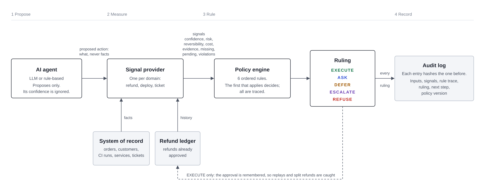

# Decision Engine

**AI agents propose. The engine rules.**

A decision layer that sits between AI agents and the systems they act on. For every proposed action it returns one of five rulings (**execute, ask, defer, escalate, refuse**) with the confidence, risk, evidence, missing information and reversibility behind it, and seals the result in a tamper-evident audit trail.

The language model never decides. It only proposes; deterministic rules, checked against facts the engine looks up itself, make the call.

- **Live demo:** `https://YOUR-APP.onrender.com` (free hosting: the first load after idle can take about a minute)
- **Walkthrough video:** `https://loom.com/share/...`
- Built for the DOO Builders League, *The Decision Engine* challenge.

---

## Run it locally

Requirements: **Java 17 or newer**. Nothing else; Maven comes with the project.

```bash
git clone https://github.com/YOUR-USERNAME/decision-engine.git
cd decision-engine
./mvnw spring-boot:run          # Windows: mvnw.cmd spring-boot:run
```

Open **http://localhost:8081**. Run the tests with `./mvnw test`.

### Optional: a real LLM agent

Without configuration, a built-in rule-based agent proposes actions. To use a real model, copy `.env.example` to `.env` and fill it in. Any OpenAI-compatible API works:

| Provider | `LLM_BASE_URL` | `LLM_MODEL` (example) |
|---|---|---|
| Google Gemini | `https://generativelanguage.googleapis.com/v1beta/openai` | a current Flash model |
| Groq | `https://api.groq.com/openai/v1` | `llama-3.3-70b-versatile` |

If the LLM is unreachable or rate-limited, the app falls back to the rule-based agent automatically, and says so in the audit trail.

### Run with Docker

```bash
docker build -t decision-engine .
docker run -p 8081:8081 -e PORT=8081 decision-engine
```

---

## How a decision is made



1. **The agent proposes.** It says *what* it wants to do (`refund $900 on order A-1002`), never the facts. Its self-reported confidence is recorded but never used: an agent grading its own homework is not evidence.
2. **A signal provider measures it.** Each domain (refunds, deploys, support tickets) looks up the real facts in the system of record and produces **signals**: confidence, risk, reversibility, cost of being wrong, the evidence checked, what is missing, what is still pending, and any hard-policy violations.
3. **The policy engine rules.** Six rules are checked in order and the first that applies decides:

   | # | Rule | Ruling |
   |---|---|---|
   | 1 | A hard policy forbids it | **Refuse** |
   | 2 | Information only the requester has is missing | **Ask** |
   | 3 | Evidence is still on its way (CI running, return in transit) | **Defer** |
   | 4 | Confidence is below 80% | **Escalate** |
   | 5 | High risk, cost above $500, or irreversible and above $100 | **Escalate** |
   | 6 | Otherwise | **Execute** |

   Every rule is still evaluated, so each decision carries a full **trace** of why each rule did or did not apply, plus a concrete **next step** (the question to ask, what to wait for, or which approver).
4. **The record is sealed.** Each audit entry stores the hash of the previous one (SHA-256), so editing or deleting history is detectable at `/api/audit/verify`. Every entry also records the **policy version** that produced it.

### Key design decisions

- **Refuse comes only from explicit hard policies.** Risk alone can at most escalate, so a large but legitimate request reaches a human instead of being silently denied.
- **Ask, defer and escalate mean different things.** Ask: only the requester can fix it. Defer: waiting alone will settle it. Escalate: a person with authority must judge it.
- **Facts come from the system of record, not the request.** An agent cannot claim "0 previous refunds" or "tests passed"; the engine checks.
- **The engine has memory.** A refund ledger and a per-customer daily limit stop replay and salami attacks (see the failure test below).
- **Unknown means no.** An action in a domain the engine has no rules for is refused, not guessed.

---

## Three domains

| Domain | The agent sends | The engine looks up | Example rulings |
|---|---|---|---|
| **Refund approval** | order id, amount | order total and status, customer history, fraud hold, refunds already approved | small refund executes; refund above the order total is refused; $1,200 refund escalates to finance |
| **Code deploy** | service, environment, commit | CI status, rollback availability, change freezes, change size | green deploy executes; running CI defers; failing CI or a freeze is refused |
| **Ticket triage** | ticket id, queue or reply | ticket text, customer tier; the engine's own classifier and injection checks | agent and engine disagree on the queue: escalates; auto-reply to a prompt-injected ticket is refused |

The data in `src/main/resources/data/` is synthetic but realistic: 13 orders, 7 customers, 8 tickets, 4 services and 6 CI runs.

---

## The deliberate failure test

The first version judged every request in isolation, and that broke it: the **same $25 refund on a $45 order, filed ten times, was approved ten times**, and a large refund split into small ones slipped under every threshold. The fix (a refund ledger and a velocity limit) and what still breaks are written up in **[docs/failure-test.md](docs/failure-test.md)** and enforced by `FailureTest.java`.

---

## API

| Method | Path | What it does |
|---|---|---|
| `POST` | `/api/decide` | Submit a proposed action, get a ruling with its audit entry |
| `POST` | `/api/agent/tickets/{id}` | Let the AI agent read a ticket and propose; the engine rules |
| `POST` | `/api/scenarios/{id}/run` | Dry-run a curated scenario (nothing is remembered as executed) |
| `GET` | `/api/scenarios`, `/api/tickets` | The scenario library and the ticket inbox |
| `GET` | `/api/audit`, `/api/audit/{id}` | The decision record, newest first |
| `GET` | `/api/audit/verify` | Check the hash chain |
| `GET` | `/api/policy` | Rules in force, policy version, active agent |

```bash
curl -X POST localhost:8081/api/decide -H "Content-Type: application/json" \
  -d '{"domain":"refund","type":"issue_refund","requester":"me","params":{"orderId":"A-1001","amount":25}}'
```

---

## Project structure

```
src/main/java/com/yasser/decisionengine/
  model/      Immutable records: ProposedAction, Signals, Decision, RuleCheck, AuditEntry
  data/       System of record, loaded from synthetic JSON
  signals/    One signal provider per domain, plus the engine's own text checks
  engine/     PolicyEngine (ordered rules) and DecisionService (decide / preview)
  ledger/     RefundLedger: refunds already approved
  audit/      Hash-chained AuditLog
  agent/      LLM and rule-based proposers, TicketAgent loop
  demo/       Curated scenarios and the startup seed
  api/        REST controller
src/main/resources/static/   The demo site: HTML, CSS (tokens, base, layout, components), JS modules
docs/                        Failure test, architecture, thesis
```

39 tests cover every ruling in every domain, the hash chain, the agent loop, LLM fallback, and the failure test.

---

## Notes for reviewers

**What to look at first:** open the live demo; it opens on ticket T-102, a prompt injection asking for a $900 refund on a $60 order. Then try *Draft an action* and file the same refund twice.

**AI tools used:** Claude (Anthropic) as a pair programmer for design review, code and documentation; every change was reviewed, run and tested by me. Google Gemini is the optional runtime agent that proposes actions.

**Intentionally out of scope:**
- Persistence: the audit log and the refund ledger live in memory and reset on restart. The demo re-seeds sample decisions at startup.
- Authentication and per-agent identity: any caller can submit actions.
- Executing actions: an `EXECUTE` ruling is the end of the pipeline; nothing is actually refunded or deployed.
- Policies as configuration: thresholds are constants in `PolicyEngine`, versioned by `POLICY_VERSION`.

**This breaks when…** the system of record is wrong (the engine trusts it), an injection is paraphrased past the keyword checks (facts still protect refunds, not ticket routing), or the app restarts and the in-memory ledger forgets past approvals. Details in [docs/failure-test.md](docs/failure-test.md).
